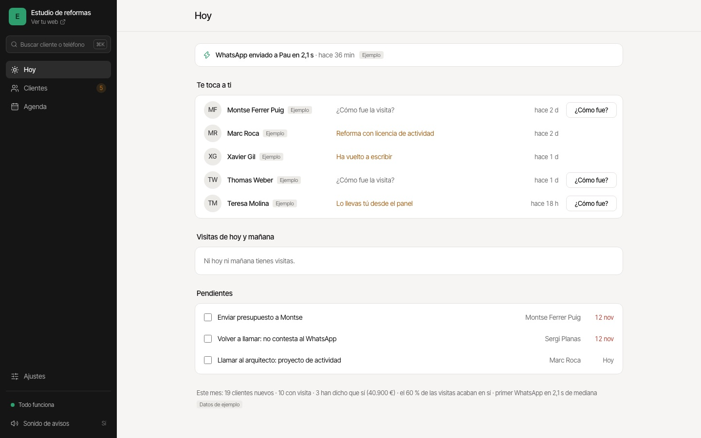
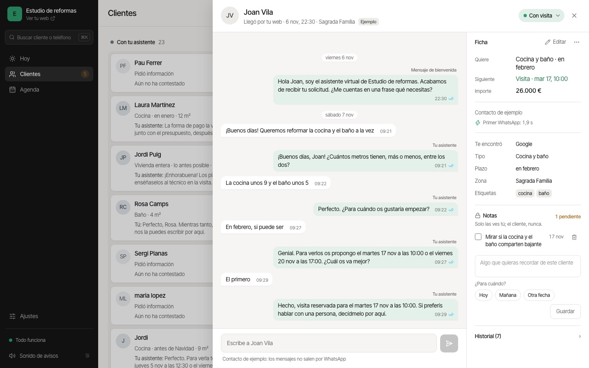
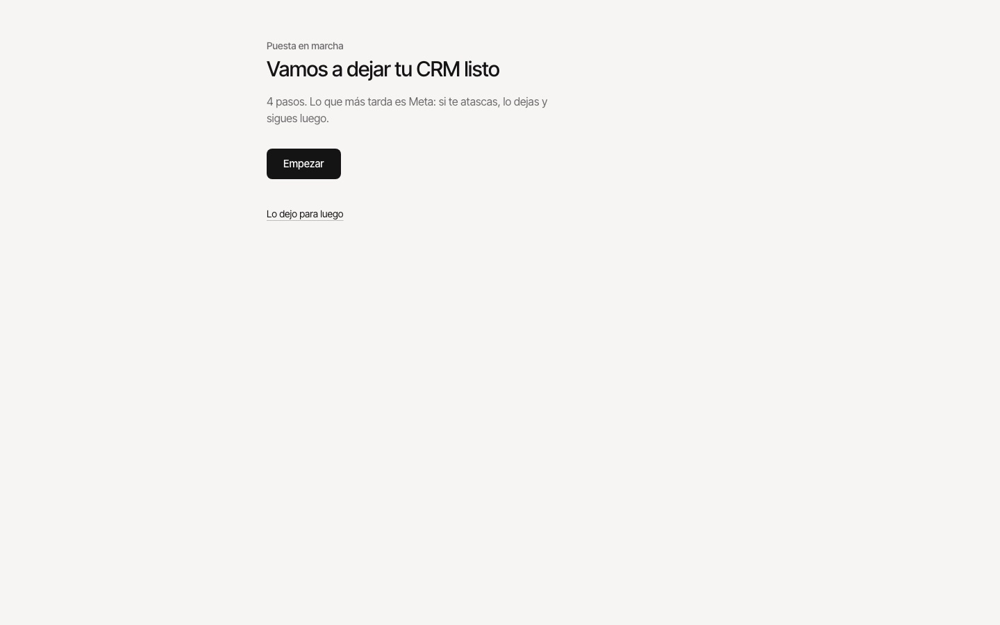
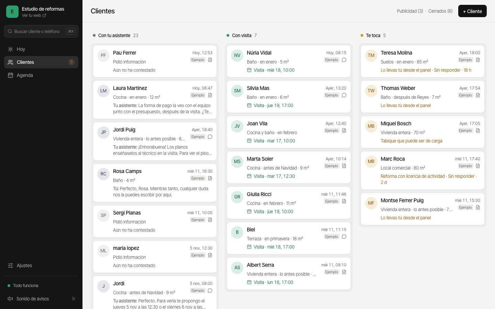
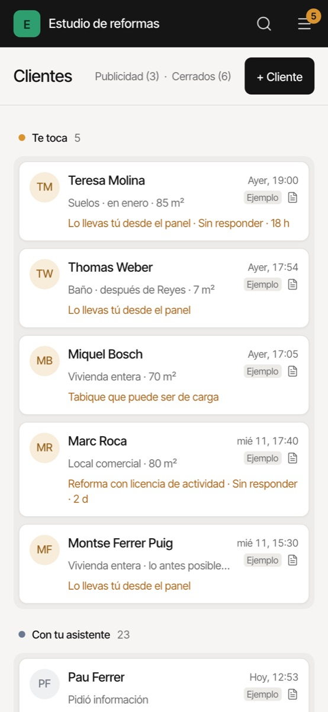

# CRM de WhatsApp con IA para cualquier negocio

Un CRM ya hecho que contesta a tus clientes por WhatsApp en segundos con Claude, les pregunta lo que falta y lo apunta en su ficha, les da
cita en un hueco libre de tu agenda y te avisa cuando hace falta una persona. Funciona con la API oficial de WhatsApp de Meta y todo queda
en un panel con tres pantallas: Hoy, Clientes y Agenda. Es gratis, con licencia MIT, y lo adaptas a tu negocio con un mensaje a Claude.

Revisada el 18 de noviembre de 2026 con su documentación (enlace al final). Se instala en un Mac.



---

## Cómo funciona

1. Tu cliente pulsa el botón de WhatsApp de tu web y te escribe con un mensaje ya puesto, por ejemplo «Hola, quiero pedir presupuesto para una reforma».
2. Tu asistente le contesta al momento, le pregunta lo que falta y lo guarda en su ficha.
3. Le ofrece huecos libres de tu agenda y le reserva la cita.
4. Si el cliente pide hablar con alguien, está molesto o el caso lo pide, te lo pasa, deja de contestar y te avisa.

Las citas las controla el código, no la IA: tu asistente solo puede dar un hueco que esté libre de verdad, y cada respuesta se revisa
antes de enviarla. Si cita horas que no se han ofrecido o se inventa un precio, se descarta y se rehace.



## Lo que hace falta

- **Un Mac** con Node.js 22.13 o posterior. Si no lo tienes, el instalador te da el enlace.
- **Una clave de Claude** con saldo.
- **Una app de Meta** con WhatsApp, su token permanente y su clave secreta.
- **Una cuenta gratuita de ngrok,** para que los mensajes de WhatsApp lleguen a tu ordenador.

## 1. Instálalo

Pega esto en la app Terminal de tu Mac:

```bash
curl -fsSL https://raw.githubusercontent.com/OrbyOS/crm-whatsapp-ia/main/instalar.sh | bash
```

Se instala en la carpeta `crm-whatsapp` de tu usuario y se abre en el navegador. Los días siguientes, doble clic en **«Abrir CRM»**, dentro de esa
carpeta. Si vuelves a pegar el comando, se actualiza sin tocar tus datos ni tus claves.

## 2. La puesta en marcha

La primera vez, el CRM te guía en cuatro pasos y cada uno te dice si ya está hecho:

1. **Tu negocio:** el tipo (Reformas, Inmobiliaria, Clínica u Otro), el nombre y, si quieres, el logo.
2. **Tu asistente:** pega tu clave de Claude.
3. **Tu WhatsApp:** el token de Meta, la clave secreta de tu app y el token de ngrok. Con «Conectar», el CRM elige la cuenta y el número y lo comprueba todo.
4. **Tu primer WhatsApp:** escribe «Hola» al número de tu negocio desde tu móvil y mira cómo contesta.



Si te atascas, pulsa «Lo dejo para luego». En **Ajustes, Conexiones**, cada línea dice qué falla y, si se puede arreglar solo, tiene un botón «Arreglar».

## 3. Lo que tienes que hacer en Meta

Es lo único que no se hace desde el CRM. Si nunca has entrado en Meta for Developers, pídele a Claude que te guíe pantalla a pantalla.

1. **Crea la app** en developers.facebook.com, con el caso de uso «Connect with customers through WhatsApp».
2. **Crea un usuario del sistema** en business.facebook.com y genera un token que no caduque, con los permisos `whatsapp_business_messaging` y `whatsapp_business_management`. El token de la pantalla de inicio caduca en 24 horas: no te sirve.
3. **Copia la clave secreta** de tu app, en Configuración de la app, Básica.
4. **Añade tu móvil** a los destinatarios del número de prueba, para probarlo.
5. **Publica la app** con el enlace a tu política de privacidad. En modo desarrollo no recibe los mensajes, aunque todo lo demás esté en verde.
6. **Para clientes de verdad,** añade el número de tu negocio y un método de pago.

Para empezar no necesitas ningún mensaje aprobado por Meta: como escribe primero tu cliente, tu asistente le puede contestar con normalidad durante 24 horas.

## 4. Adáptalo a tu negocio

En **Ajustes** cambias el nombre, el logo, el color, el horario de citas y lo que hace tu asistente. Para ir más allá, como cómo llamas a tus
clientes, qué datos guarda la ficha o los textos de tu web, abre Claude Code (capítulo 3.2) en la carpeta del CRM y pídeselo:

```text
Adapta el CRM a mi negocio: [qué haces, a quién y qué tiene que preguntar tu asistente antes de dar cita]. Sigue las instrucciones de
CLAUDE.md para adaptar el CRM a otro negocio. Enséñame el archivo del negocio antes de aplicarlo y no toques mis clientes.
```

Antes de dejarle atender a nadie, pruébalo en **Ajustes, Probar tu asistente**, que además te dice lo que cuesta cada prueba.



## Cada día

- **Hoy:** quién acaba de llegar, a quién te toca contestar y por qué, las visitas de hoy y mañana y tus pendientes.
- **Clientes:** un tablero con tres columnas que se mueven solas («Con tu asistente», «Con visita» y «Te toca»). Al abrir un cliente puedes cogerle tú, darle cita o devolvérselo a tu asistente.
- **Agenda:** tus citas, día por día.

El panel también funciona en el móvil, con «Te toca» arriba.



## Lo que cuesta

- **El CRM es gratis,** con licencia MIT.
- **Claude** cobra por uso, según el modelo que elijas.
- **Meta** cobra por mensaje según su categoría y el país. Las respuestas a quien te escribe primero tienen condiciones distintas: mira su [página de precios](https://developers.facebook.com/documentation/business-messaging/whatsapp/pricing).
- **ngrok,** con el plan gratuito basta.
- **Tus datos** se guardan en tu ordenador, sin pagar ninguna base de datos.

Si quieres que esté encendido las 24 horas en tu propio dominio, tiene un modo servidor. Los pasos están en `DESPLEGAR.md`, dentro del repositorio.

> [!CAUTION]
> **Tú eres responsable de los datos de tus clientes.** Pon el enlace a tu política de privacidad en Ajustes, y borra los datos de quien te
> lo pida (en su ficha, «Borrar sus datos»). Tu asistente se presenta siempre como asistente virtual. Y no uses el «Modo prueba» con el
> número de tu negocio: no es la vía oficial y WhatsApp puede bloquearlo.

## Lo que no hace todavía

Funciona en Mac, no en Windows. No manda recordatorios el día antes de la cita, ni reparte clientes entre varias personas del equipo, y
cada hueco es para una sola cita, todas de la misma duración.

## En resumen

- Un CRM ya hecho que contesta por WhatsApp con Claude, da cita y te avisa cuando te toca.
- Un comando en el Mac y una puesta en marcha de cuatro pasos.
- La app de Meta es lo único que se hace fuera del CRM.
- Lo adaptas a tu negocio con un mensaje a Claude Code.
- Gratis, con licencia MIT. Pagas el uso de Claude y los mensajes de Meta.

---

## Fuentes

- [Repositorio del CRM de WhatsApp con IA](https://github.com/OrbyOS/crm-whatsapp-ia) (instalación, puesta en marcha, pasos de Meta, costes, límites y licencia).

---

Hecha por [Orby](https://orbyos.es). Más guías y skills gratuitas en este mismo repositorio.
